> **Pines verificados:** las tablas de patillaje de esta guía pueden no coincidir con los archivos KiCad. Para el cableado, los pines, los jumpers y la Raspberry Pi 5 usa [`guia_cableado_pi5.md`](guia_cableado_pi5.md); si difieren, manda esa.

> **Nota:** esta guía es la traducción y adaptación al español de la documentación de [qbancoffee/imac_g3_ivad_board_init](https://github.com/qbancoffee/imac_g3_ivad_board_init) (LGPL-3.0). Las imágenes están en [`originales/imagenes/`](../originales/imagenes/) (fotos reducidas a 1600 px). Está escrita para una Raspberry Pi 4: con **Raspberry Pi 5** usa `dtoverlay=vc4-kms-v3d` y fija la resolución en `/boot/firmware/cmdline.txt` (por ejemplo `video=HDMI-A-1:1024x768M@60D`), porque las directivas HDMI clásicas de `config.txt` se ignoran. Revisa las tablas de patillaje de J20 y J22 contra los [esquemas originales](../originales/esquemas_pdf/) antes de cablear.

# Guía Completa de Implementación: MacBerry Pi
### Conversión de iMac G3 DV (Slot Loading) en Monitor VGA y Centro Multimedia con Raspberry Pi sin Modificaciones Destructivas

---

## 1. Introducción y Filosofía del Proyecto

El **iMac G3** es uno de los ordenadores más icónicos de la historia del diseño industrial. Su formato "todo en uno" en forma de gota de agua y su carcasa translúcida marcaron una época. Sin embargo, su hardware original ya no permite navegar por la web moderna ni ejecutar software actual.

Muchos proyectos optan por vaciar por completo el chasis, retirar el tubo de rayos catódicos (CRT) e instalar una pantalla plana LCD. Aunque es una solución válida cuando el tubo está roto, para los entusiastas de lo retro la calidez, nitidez en bajas resoluciones y respuesta de un tubo CRT original son insustituibles.

**El objetivo de esta guía ("MacBerry Pi")** es convertir un **iMac G3 DV (modelos Slot Loading de 350 a 700 MHz)** en un monitor VGA de alta calidad con sonido integrado, permitiendo alojar en su interior un ordenador monoplaca (SBC) como una **Raspberry Pi 4**, un PC x86 compacto o cualquier fuente de vídeo externa, **sin destruir el CRT y de forma 100% reversible** (pudiendo volver a montar la placa base original de Apple cuando se desee).

```
+-------------------------------------------------------------------------+
|                              iMac G3 DV                                 |
|                                                                         |
|   +-------------------+                     +-----------------------+   |
|   |                   |    24/48 VAC        |                       |   |
|   |  Placa Analógica  | ------------------> |    Placa Reductora    |   |
|   |     (PAV/CRT)     |                     |    (Down Converter)   |   |
|   |                   | <------------------ |                       |   |
|   +-------------------+    DCO / Encendido  +-----------------------+   |
|             |                                        | +12V / +5V / +3.3V|
|             | I2C (Inicialización)                   v                   |
|             v                               +-----------------------+   |
|   +-------------------+                     |                       |   |
|   |    Placa IVAD     |                     |  Raspberry Pi / SBC   |   |
|   | (Cuello del CRT)  | <================== |   + Amplificador de   |   |
|   +-------------------+    RGB / HSync/VSync|         Audio         |   |
|                                             |                       |   |
|                                             +-----------------------+   |
+-------------------------------------------------------------------------+
```

---

## 2. Advertencias de Seguridad Críticas

> [!CAUTION]
> **ALTO VOLTAJE EN EL CRT:** El tubo CRT y la placa analógica acumulan miles de voltios (hasta 25.000 V) en el ánodo del tubo y condensadores grandes, **incluso cuando el iMac lleva días desenchufado de la corriente**.
> - Descarga siempre el tubo con una sonda de descarga a tierra antes de manipular cerca del ánodo o el flyback.
> - Si no estás seguro de cómo manipular un monitor CRT de forma segura, busca asistencia técnica o mantén tus manos alejadas de la placa analógica superior.

> [!WARNING]
> **FRAGILIDAD EXTREMA DE LOS PLÁSTICOS:** Con más de dos décadas de antigüedad, el plástico interior (especialmente el bisel interior o *inner bezel*) es extremadamente quebradizo y puede romperse ante la mínima torsión. Desmonta el chasis con suavidad siguiendo el [Manual de Servicio de Apple](https://www.ifixit.com/Document/OBF5tQG3oqWwfuaX/G3-Disassembly.pdf).

> [!IMPORTANT]
> **DESCARGA ELECTROSTÁTICA (ESD):** La electricidad estática de tus manos puede destruir los circuitos integrados y microcontroladores. Trabaja siempre sobre una superficie antiestática y conéctate a tierra.

---

## 3. Arquitectura y Funcionamiento Interno del iMac G3 Slot Loading

Para que el CRT funcione fuera del sistema original de Apple, es necesario comprender cómo se comunican sus componentes:

### 3.1. Las Placas Internas
1. **Placa Analógica (PAV):** Ubicada debajo del tubo CRT, se encarga de la alimentación general de alta y baja tensión, el transformador de líneas (*flyback*) y la deflexión horizontal/vertical.
2. **Placa IVAD (Interactive Video Adjustment Device):** Es la pequeña placa de circuito impreso conectada directamente al cuello del tubo CRT. Controla los cátodos RGB, el enfoque, la polarización y la geometría del haz a través de comandos digitales I2C.
3. **Placa Reductora (Down-Converter Board):** Conectada en la bandeja inferior. No es una fuente de alimentación completa conectada a la red; recibe 24/48 VAC de la placa analógica y genera los voltajes de corriente continua (+12V, +5V, +3.3V) para la placa base y los discos.

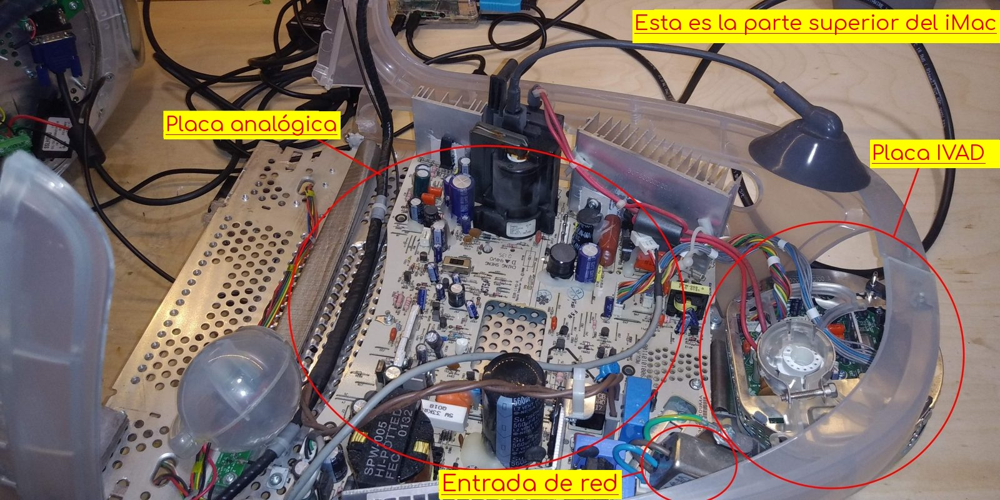

### 3.2. Secuencia de Encendido Original
1. **Modo de espera (Standby):** Al enchufar el iMac a la red eléctrica (110/220 VAC), la placa analógica se energiza parcialmente y entrega un voltaje residual (*trickle voltage*) de **5V DC** a través de la placa IVAD hacia el conector **J20**.
2. **Pulsación del botón de encendido:** Al pulsar el botón de encendido frontal (enrutado a través de **J22**), el circuito de control de la placa base une el pin 6 (*trickle voltage*) de J20 con los pines 10 (**PFW**) y 12 (**LP**).
3. **Arranque de la placa reductora:** Esta unión envía la señal de encendido a la placa reductora, que a su vez suministra +12V, +5V y +3.3V DC.
4. **Inicialización por I2C:** La CPU/controlador del iMac envía una secuencia de comandos digitales por el bus **I2C** (direcciones `0x46` y `0x53`) a través de los pines 1 (SDA) y 2 (SCL) del conector J20 hacia la placa IVAD.
5. **Apertura del vídeo:** Una vez inicializada la placa IVAD, el CRT "despierta" (emitiendo el característico sonido de desmagnetización y alta tensión) y queda listo para recibir las señales de vídeo analógicas RGB y sincronismos (HSync/VSync).

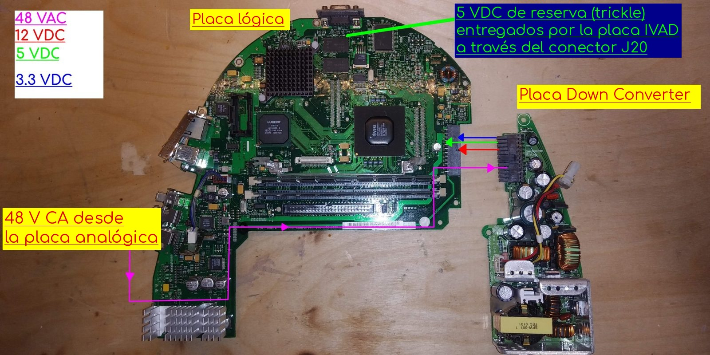

---

## 4. Conectores del Chasis: J20 y J22

Al retirar la placa base (*logic board*) del chasis del iMac G3, quedan expuestos dos conectores clave que enlazan todo el sistema:

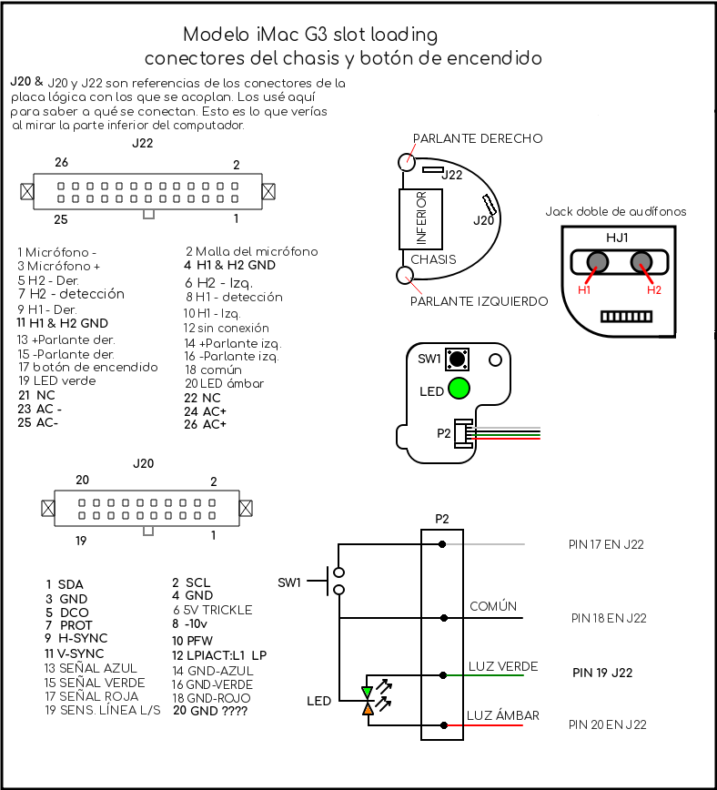
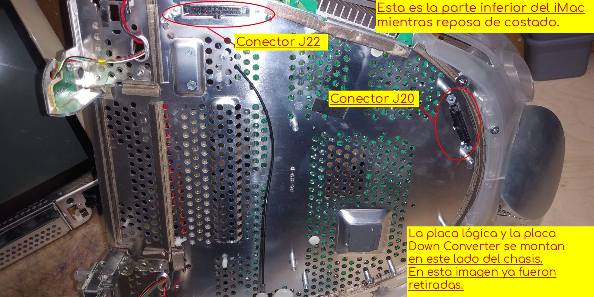

### Patillaje del Conector J20 (Vídeo, I2C y Control de Encendido)
| Pin J20 | Función | Descripción / Destino |
|:---:|:---|:---|
| **1** | **SDA** | Línea de datos I2C hacia la placa IVAD |
| **2** | **SCL** | Línea de reloj I2C hacia la placa IVAD |
| **3** | **GND** | Masa lógica I2C |
| **4** | **GND** | Masa de vídeo / blindaje |
| **5** | **GND** | Masa de vídeo / blindaje |
| **6** | **+5V Trickle** | Tensión de espera constante (+5V DC desde la analógica) |
| **7** | **GND** | Masa |
| **8** | **PROT** | Señal de protección (5V apaga todo el sistema) |
| **9** | **Red / Rojo** | Señal de vídeo analógica Roja (VGA Pin 1) |
| **10** | **PFW** | *Power Fail Warning* (Puente a +5V Trickle para encendido) |
| **11** | **Green / Verde** | Señal de vídeo analógica Verde (VGA Pin 2) |
| **12** | **LP** | *Logic Power On* (Puente a +5V Trickle para encendido) |
| **13** | **Blue / Azul** | Señal de vídeo analógica Azul (VGA Pin 3) |
| **14** | **GND** | Masa |
| **15** | **HSync** | Sincronismo Horizontal VGA (VGA Pin 13) |
| **16** | **GND** | Masa |
| **17** | **VSync** | Sincronismo Vertical VGA (VGA Pin 14) |
| **18** | **GND** | Masa |
| **19** | **NC / Reservado** | Sin conexión |
| **20** | **NC / Reservado** | Sin conexión |

---

### Patillaje del Conector J22 (Audio, Botón de Encendido, LEDs y AC)
| Pin J22 | Función | Descripción |
|:---:|:---|:---|
| **1 - 4** | **24 / 48 VAC** | Entrada de corriente alterna desde la placa analógica |
| **5** | **GND** | Masa general |
| **6** | **Power Button** | Entrada del pulsador de encendido frontal |
| **7** | **Green LED** | Ánodo del LED de encendido verde |
| **8** | **Amber LED** | Ánodo del LED de espera ámbar |
| **9** | **Speaker Left +** | Salida altavoz izquierdo (+) |
| **10** | **Speaker Left -** | Salida altavoz izquierdo (-) |
| **11** | **Speaker Right +**| Salida altavoz derecho (+) |
| **12** | **Speaker Right -**| Salida altavoz derecho (-) |
| **13 - 16**| **Audio Jack / Mic**| Conexiones para conectores de auriculares y micrófono |

---

## 5. Fabricación del Cable VGA y Arnés de Conexión

Si decides realizar la conversión cableando directamente sin las placas PCB personalizadas, deberás construir un cable adaptador entre el conector **DE15 (VGA estándar)** y el conector **J20**.

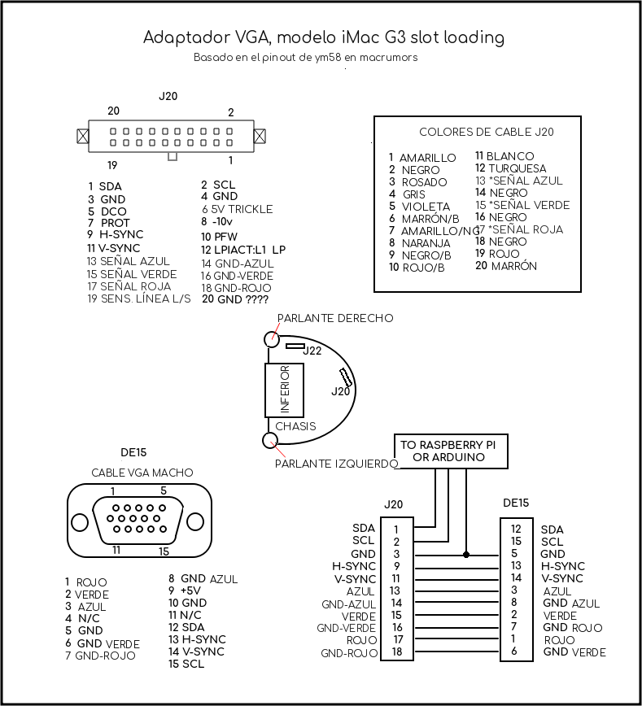

### Procedimiento para Fabricar el Cable:
1. **Cortar un cable VGA de calidad:** Corta un extremo del cable dejando al menos uno de los núcleos de ferrita cilíndricos en el tramo útil.
2. **Pelar y verificar continuidad:** Pela la funda unos 8 a 10 cm. Con un multímetro en modo continuidad, identifica qué cable de color corresponde a cada pin del conector DE15.
3. **Mapeo DE15 a J20:**
   - **Pin 1 DE15 (Rojo)** $\rightarrow$ **Pin 9 J20** (Masa coaxial a Pin 4 J20)
   - **Pin 2 DE15 (Verde)** $\rightarrow$ **Pin 11 J20** (Masa coaxial a Pin 5 J20)
   - **Pin 3 DE15 (Azul)** $\rightarrow$ **Pin 13 J20** (Masa coaxial a Pin 7 J20)
   - **Pin 13 DE15 (HSync)** $\rightarrow$ **Pin 15 J20**
   - **Pin 14 DE15 (VSync)** $\rightarrow$ **Pin 17 J20**
   - **Pin 5, 6, 7, 8, 10 DE15 (GND)** $\rightarrow$ **Pines de masa (GND) de J20**
   - **Pin 12 DE15 (SDA EDID)** $\rightarrow$ Conectar a pin SDA del microcontrolador emulador de EDID.
   - **Pin 15 DE15 (SCL EDID)** $\rightarrow$ Conectar a pin SCL del microcontrolador emulador de EDID.

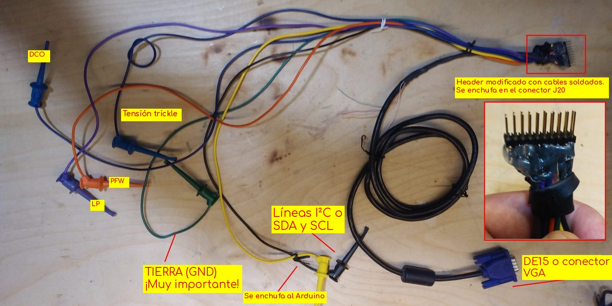

---

## 6. Placas de Circuito Impreso Personalizadas (PCBs)

Para una instalación limpia, profesional y libre de errores de cableado, se diseñaron tres placas de circuito impreso en **KiCad** usando componentes *through-hole* (orificio pasante):

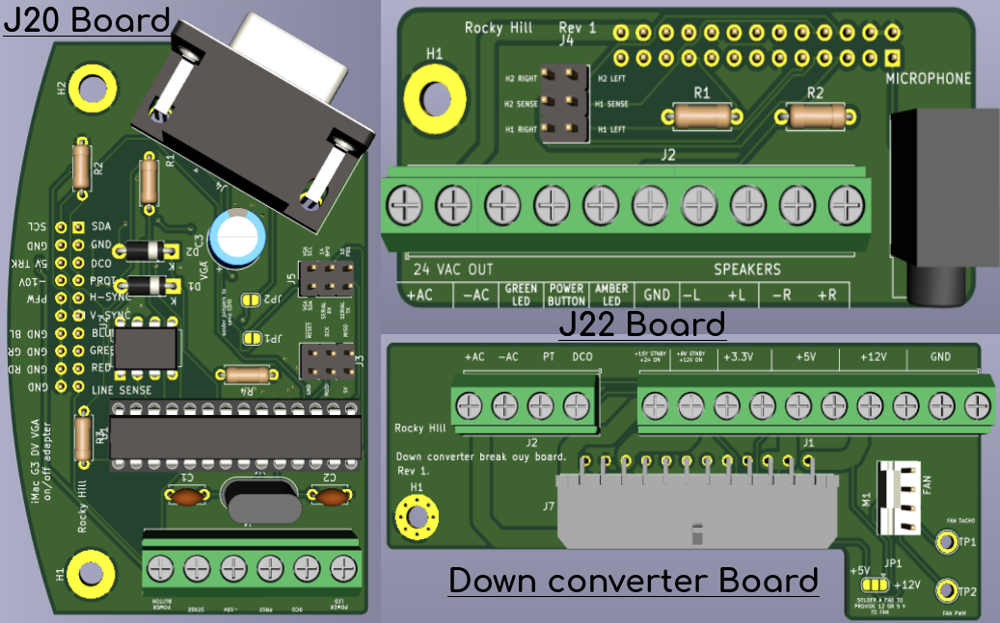

### 6.1. Placa Adaptadora J20 (VGA + Inicialización IVAD + Emulador EDID)
- **Función:** Es el "cerebro" del montaje. Contiene el microcontrolador **ATmega328-PU**, el puerto VGA hembra, la lógica de encendido/apagado, detección de VSYNC para modo reposo y el envío de EDID a la computadora anfitriona.
- [Descargar archivos Gerber de la Placa J20](https://github.com/qbancoffee/imac_g3_ivad_board_init/raw/master/schematics_and_pcbs/imac_g3_333mhz_slot_loading_J20_adapter_board/gerbers/imac_g3_333mhz_slot_loading_J20_adapter_board.zip)
- [Ver Esquema en PDF de la Placa J20](../originales/esquemas_pdf/j20_schematic.pdf)
- [BOM Interactiva de la Placa J20 (Visor HTML)](https://htmlpreview.github.io/?https://github.com/qbancoffee/imac_g3_ivad_board_init/blob/master/schematics_and_pcbs/imac_g3_333mhz_slot_loading_J20_adapter_board/bom/ibom.html)

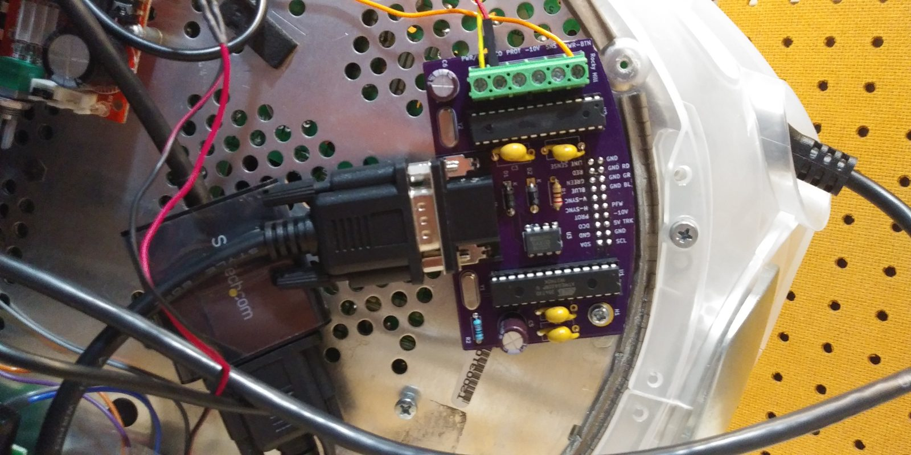

### 6.2. Placa Adaptadora J22 (Audio, Botón de Encendido y LEDs)
- **Función:** Conecta directamente a la tira de pines J22, dando acceso a los altavoces estéreo originales, botón de encendido, micrófono, LEDs frontales y conectores de auriculares.
- [Descargar archivos Gerber de la Placa J22](https://github.com/qbancoffee/imac_g3_ivad_board_init/raw/master/schematics_and_pcbs/imac_g3_slot_loading_J22_adapter_board/gerber/imac_g3_slot_loading_J22_adapter_board.zip)
- [Ver Esquema en PDF de la Placa J22](../originales/esquemas_pdf/j22_schematic.pdf)
- [BOM Interactiva de la Placa J22 (Visor HTML)](https://htmlpreview.github.io/?https://github.com/qbancoffee/imac_g3_ivad_board_init/blob/master/schematics_and_pcbs/imac_g3_slot_loading_J22_adapter_board/bom/ibom.html)

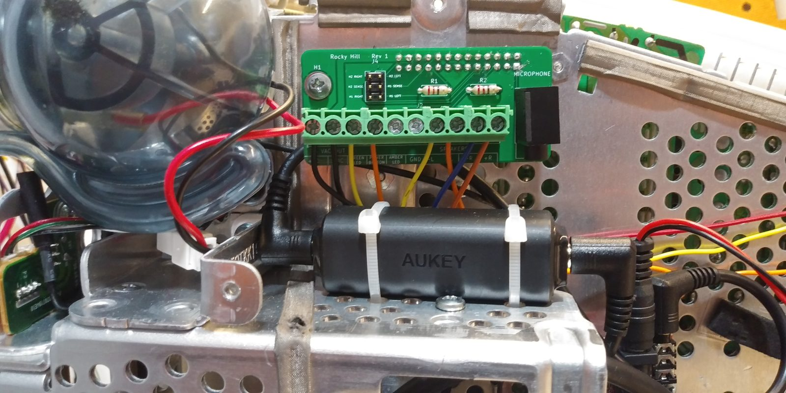

### 6.3. Placa Reductora / Down Converter Breakout Board
- **Función:** Se conecta a la placa reductora original de Apple para extraer tensiones continuas reguladas (**+12V, +5V, +3.3V**) y alimentar la Raspberry Pi, el amplificador de audio y un ventilador de refrigeración.
- [Descargar archivos Gerber de la Placa Reductora](https://github.com/qbancoffee/imac_g3_ivad_board_init/raw/master/schematics_and_pcbs/imac_g3_down_converter_board_adapter/gerber/imac_g3_down_converter_board_adapter.zip)
- [Ver Esquema en PDF de la Placa Reductora](../originales/esquemas_pdf/down_converter_breakout_board_schematic.pdf)
- [BOM Interactiva de la Placa Reductora (Visor HTML)](https://htmlpreview.github.io/?https://github.com/qbancoffee/imac_g3_ivad_board_init/blob/master/schematics_and_pcbs/imac_g3_down_converter_board_adapter/bom/ibom.html)

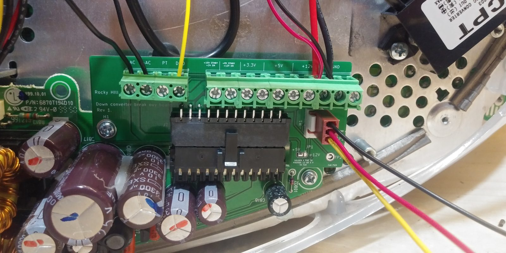

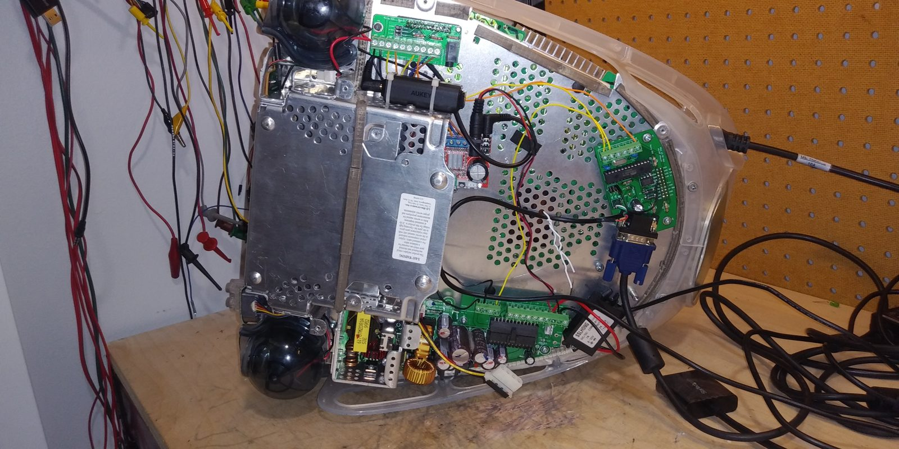

---

## 7. Programación del Microcontrolador ATmega328-PU

El microcontrolador de la placa J20 realiza dos tareas fundamentales:
1. Enviar la secuencia de inicialización I2C a la placa IVAD al pulsar el botón de encendido.
2. Responder a las solicitudes de EDID en la dirección I2C `0x50` desde la computadora conectada por VGA.

### 7.1. Modificación Obligatoria de Buffers I2C en Arduino IDE

> [!IMPORTANT]
> El bloque EDID completo tiene **128 bytes**. Por defecto, la biblioteca `Wire` de Arduino tiene un buffer máximo de 32 bytes. Debes modificar dos archivos en tu instalación del IDE de Arduino antes de compilar:

1. Abrir `.../hardware/arduino/avr/libraries/Wire/src/Wire.h` y cambiar:
   ```c
   #define BUFFER_LENGTH 128  // Originalmente 32
   ```
2. Abrir `.../hardware/arduino/avr/libraries/Wire/src/utility/twi.h` y cambiar:
   ```c
   #define TWI_BUFFER_LENGTH 128  // Originalmente 32
   ```

### 7.2. Métodos de Grabación del Firmware

#### Método 1: Grabar el chip en una placa Arduino Uno
1. Retira con cuidado el chip ATmega328P original de un Arduino Uno.
2. Inserta el chip virgen en el zócalo DIP del Arduino Uno.
3. Abre el archivo [imacG3IvadInit.ino](../firmware/imacG3IvadInit/imacG3IvadInit.ino).
4. Selecciona **Herramientas $\rightarrow$ Placa $\rightarrow$ Arduino Uno** y el puerto correspondiente.
5. Haz clic en **Herramientas $\rightarrow$ Grabar Bootloader** y luego en **Subir**.
6. Retira el chip programado y colócalo en el zócalo de la placa **J20**.

#### Método 2: Grabación In-Circuit (ICSP) en la placa J20
Puedes programar el microcontrolador directamente en la placa J20 conectando un Arduino Uno como programador ISP a la cabecera J3 (ISP):

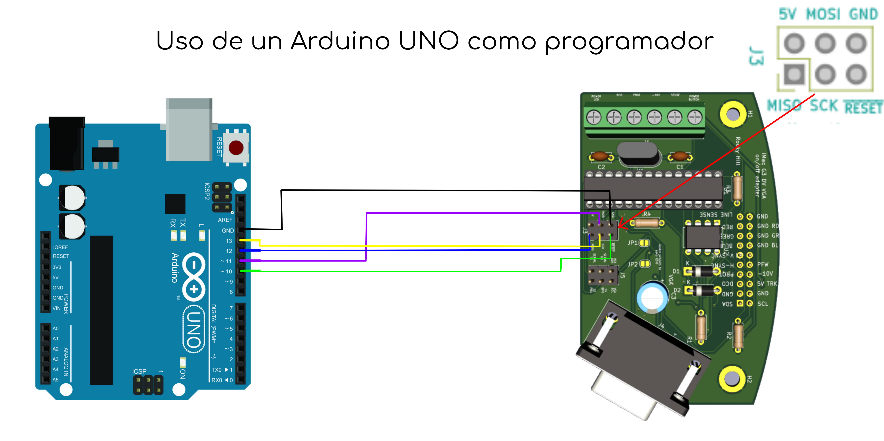

---

## 8. Integración con Raspberry Pi (MacBerry Pi)

Para crear un sistema autónomo dentro de la carcasa del iMac, la **Raspberry Pi 4** se conecta a las placas J20 y J22:

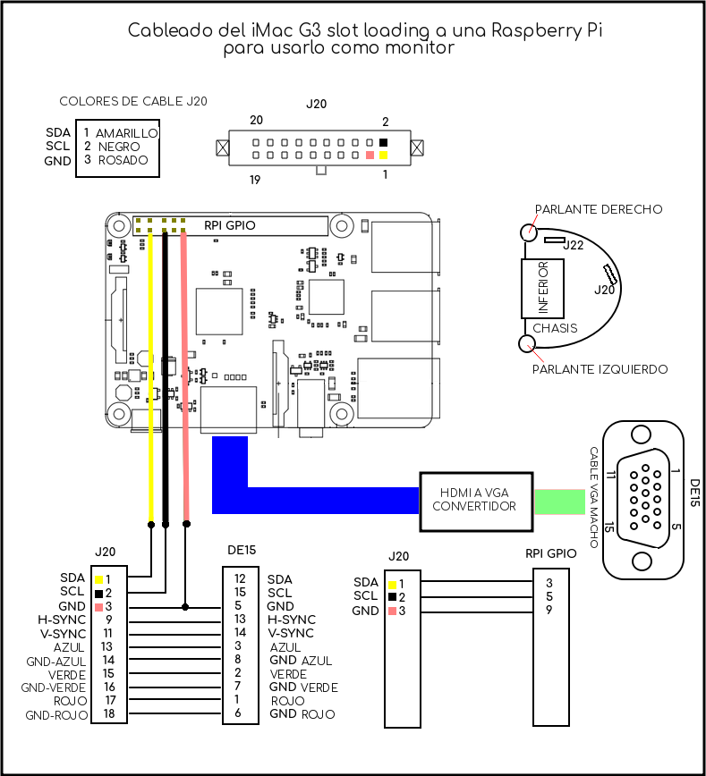

### 8.1. Configuración de Raspberry Pi OS
1. Graba Raspberry Pi OS en una tarjeta MicroSD e inicia la Raspberry Pi con monitor externo.
2. Habilita las interfaces **SSH** e **I2C** mediante:
   ```bash
   sudo raspi-config
   ```
3. Instala los paquetes necesarios:
   ```bash
   sudo apt-get update && sudo apt-get -y install i2c-tools git python3-smbus python3-rpi.gpio
   ```
4. Copia el script de inicialización [init_ivad.py](../firmware/init_ivad.py) al directorio de ejecución:
   ```bash
   sudo cp init_ivad.py /usr/local/bin/
   sudo chmod +x /usr/local/bin/init_ivad.py
   ```
5. Añade la ejecución automática en `/etc/rc.local`:
   ```bash
   sudo nano /etc/rc.local
   ```
   Agrega la siguiente línea justo antes de `exit 0`:
   ```bash
   /usr/local/bin/init_ivad.py
   ```

### 8.2. Configuración de Resolución y Controlador de Vídeo (`config.txt`)
Edita el archivo `/boot/config.txt`:
```bash
sudo nano /boot/config.txt
```
Configura el controlador de vídeo `vc4-fkms-v3d` e ignora el EDID para fijar el modo nativo del CRT:
```ini
# Desactivar KMS completo y usar Fake KMS
#dtoverlay=vc4-kms-v3d
dtoverlay=vc4-fkms-v3d

# Ajustes de vídeo para el CRT del iMac G3 (1024x768 @ 75Hz)
hdmi_ignore_edid=0xa5000080
hdmi_group=2
hdmi_mode=18
```

### 8.3. Soporte Impreso en 3D para Raspberry Pi 4
En el directorio `rpi_mount/` se incluyen los modelos STL diseñados por Rudy (https://reng.ca) para fijar de forma segura la Raspberry Pi 4 en el interior del iMac G3:
- `rpi_g3_spacer_v1.stl` (Espaciador inferior)
- `rpi_g3_plate_v2.stl` (Placa base de fijación)
- `rpi_g3_bezel_v3.stl` (Bisel adaptador de puertos)

---

## 9. Componentes y Accesorios Recomendados

| Componente | Función | Enlace / Referencia |
|:---|:---|:---|
| **Convertidor HDMI a VGA** | Adaptador de vídeo para conectar la salida HDMI de la Pi al puerto VGA | [Adaptador HDMI a VGA](https://www.amazon.com/gp/product/B074SD9RTF/) |
| **Convertidor DC-DC Step-Down** | Reduce 12V DC de la placa reductora a 5V 3A (USB-C) para la Raspberry Pi 4 | [Convertidor DC-DC](https://www.amazon.com/gp/product/B07ZQB6S3L/) |
| **Amplificador de Audio Estéreo** | Módulo amplificador de clase D (tipo PAM8403) | [Amplificador PAM8403](https://www.amazon.com/gp/product/B00LODGV64/) |
| **Aislador de Bucle de Masa** | Elimina ruidos y zumbidos parasitarios (*ground buzz*) en el audio | [Ground Loop Isolator](https://www.amazon.com/gp/product/B01L1NP7YI/) |
| **Altavoces de Reemplazo** | Altavoces de 1 pulgada 4Ω 4W compatibles con la carcasa acústica original | [Altavoces Harman/JBL 1" 4Ω](https://www.ebay.com/itm/162707444394) |
| **Conversor USB a Serie TTL** | Para conectar la PC a la placa J20 y calibrar los ajustes de imagen | [Conversor USB a TTL](https://www.amazon.com/gp/product/B00QT7LQ88/) |

---

## 10. Calibración de la Imagen: Utilidad Java y Control Serie

El microcontrolador de la placa J20 permite recibir órdenes por su puerto serie (**115200 baudios**) para ajustar en tiempo real la geometría, brillo y contraste del tubo CRT y guardarlos en la memoria EEPROM.

### 10.1. Mapeo de Teclas en Terminal Serie
Puedes abrir un emulador de terminal serie (como PuTTY, Minicom o el monitor serie de Arduino) y enviar los siguientes caracteres:

| Tecla | Acción | Tecla | Acción |
|:---:|:---|:---:|:---|
| `a` / `s` | Mover posición horizontal (Izq / Der) | `w` / `z` | Mover posición vertical (Arriba / Abajo) |
| `d` / `f` | Anchura de pantalla (Estrecho / Ancho) | `r` / `c` | Altura de pantalla (Alto / Bajo) |
| `g` / `h` | Contraste (Disminuir / Aumentar) | `j` / `k` | Brillo (Disminuir / Aumentar) |
| `x` / `v` | Inclinación paralelogramo (Izq / Der) | `b` / `n` | Corrección trapezoidal (Top / Bottom) |
| `t` / `y` | Rotación de imagen (Antihorario / Horario) | `u` / `i` | Efecto cojín / Pincushion (Expandir / Contraer) |
| `p` | Imprimir valores actuales en consola | `o` | Apagar circuitería CRT |

### 10.2. Panel de Control Gráfico en Java (`ImacG3DVDisplayProperties`)
El repositorio incluye una aplicación gráfica desarrollada en Java Swing en la carpeta `ImacG3DVDisplayProperties/`. Permite calibrar la pantalla de forma visual mediante botones interactivos:

```bash
cd ImacG3DVDisplayProperties/dist
java -jar "ImacG3DVDisplayProperties.jar"
```

---

## 11. Lista de Modos de Vídeo (Modelines para Linux/X11)

Para sistemas Linux tradicionales o configuraciones con `xrandr`, el archivo [imac_g3_modelines.txt](traducciones/imac_g3_modelines.txt) proporciona las temporizaciones nativas:

```text
Modeline "1024x768" 78.75 1024 1044 1140 1328 768 781 784 820 +hsync +vsync ratio=4:3
Modeline "800x600"  62.40  800  821  901 1040 600 609 612 644 +hsync +vsync ratio=4:3
Modeline "640x480"  49.90  640  657  721  832 480 481 484 514 +hsync +vsync ratio=4:3
```

---

## 12. Enlaces a Vídeos y Recursos del Proyecto

- [Vídeo: Inicialización de la placa IVAD con Arduino Uno](https://youtu.be/JLaHMjQ7idI)
- [Vídeo: Modificando el iMac G3 DV usando únicamente una Raspberry Pi](https://youtu.be/xSiqchucFE4)
- [Vídeo: Ensamblaje paso a paso de la placa J20](https://youtu.be/qILuajxscnE)
- [Vídeo: Ensamblaje paso a paso de la placa J22](https://youtu.be/JCPRYKbwKyk)
- [Vídeo: Funcionamiento de las tres placas instaladas](https://youtu.be/dqxeiFkvuYg)
- [Vídeo: Híbrido MacBerry Pi ejecutando RetroPie](https://youtu.be/CLCZFmmEnno)
- [Vídeo: Ajuste de parámetros de pantalla con la GUI en Java](https://youtu.be/zrzcvThxDeY)
- [Vídeo: Jugando en el iMac G3 con NES (Duck Hunt y Super Mario Bros)](https://youtu.be/wCEGIwrCOMQ)

---

## 13. Agradecimientos y Créditos
- **qbancoffee (Rocky Hill):** Creador del proyecto, ingeniería inversa de la placa IVAD y diseño de las placas PCB.
- **Rudy (https://reng.ca):** Diseño de los soportes 3D para Raspberry Pi 4 y módulos HAT.
- **sparpet & anotherelise (MacRumors):** Captura y análisis de las tramas de inicialización I2C.
- **oshimai:** Extracción de bloques EDID limpios y protocolo de comunicación VSYNC.
- **Eric Bylenga & ym58:** Mapeo inicial de pines de las placas PAV y conectores de vídeo.
