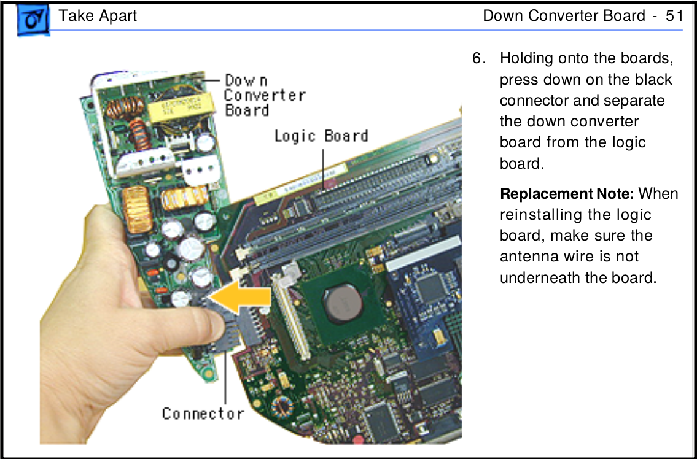

> Traducción al español del README de [qbancoffee/imac_g3_ivad_board_init](https://github.com/qbancoffee/imac_g3_ivad_board_init) (LGPL-3.0). Autoría original: qbancoffee. Las imágenes están en [`originales/imagenes/`](../../originales/imagenes/) (fotos reducidas a 1600 px).

# Añadir placas personalizadas a un iMac G3 DV (slot loading) para usarlo como monitor sin tener que destruirlo.


Consulta la wiki para ver una explicación de cómo se hizo esto.<BR>

<H2>Wiki que explica cómo se hizo esto.</H2>
 
- [Wiki que explica cómo se hizo esto.](https://github.com/qbancoffee/imac_g3_ivad_board_init/wiki)

Si tienes una placa base (logic board) dañada pero un tubo CRT funcional, estas placas te permitirán usar tu iMac G3 DV como monitor VGA para que puedas utilizarlo con una computadora de escritorio moderna. Incluso puedes cablear todo a mano sin necesidad de las placas si así lo deseas.

Incluso si tienes un iMac G3 DV perfectamente funcional, puedes retirar tu placa base y usar estas placas para convertir tu iMac G3 DV en un monitor VGA sin dañar tu iMac G3; y cuando quieras recuperar tu iMac, puedes retirar las placas personalizadas y volver a conectar tu placa base original para seguir utilizando tu iMac G3 como un producto Apple original.
Estas placas están diseñadas para conectarse directamente sin tener que modificar la carcasa ni los componentes acoplados.

Sin embargo....

# --->HAZ ESTO BAJO TU PROPIO RIESGO<--- ya que los componentes pueden romperse al desmontar tu iMac y puedes recibir una descarga eléctrica.

Aunque el riesgo es bajo, las cosas siempre pueden salir mal, así que ten cuidado.

- El bisel interior es extremadamente frágil y suele romperse con facilidad.
- El CRT puede retener carga eléctrica y darte una descarga incluso si el iMac está desenchufado.
- La descarga estática de tus manos puede destruir componentes electrónicos, así que "CONÉCTATE A TIERRA".

 He documentado gran parte del patillaje (pinouts) de los conectores del chasis del iMac G3 slot loader en este repositorio y lo usé como guía para crear placas de circuito adaptadoras (breakout boards) que se conectan directamente a los conectores del chasis y proporcionan conexiones estándar para que una computadora normal pueda usar elementos como el CRT, altavoces, botón de encendido, conectores de audio, la placa reductora (down-converter), etc.
 
 No fue fácil, pero afortunadamente muchas personas han compartido sus hallazgos en línea...
 
 Hay código funcional aquí tanto para Arduino como para Raspberry Pi para inicializar la placa IVAD de modo que puedas usarla como monitor.
 
El sketch de inicialización actual espera a que se presione un botón en un pin de Arduino para enviar la secuencia de inicialización a la placa IVAD, pero puedes simplemente descomentar "initIvadBoard();" en "setup()" para enviarla tan pronto como reciba alimentación.

</br>

Además, es posible que tengas que modificar los valores en la secuencia de inicialización para obtener el brillo, contraste y geometría de pantalla adecuados para tu configuración. A continuación se muestra un ejemplo del sketch de inicialización.


```c
  writeToIvad( 0x46, 0x04, 0x80); //rojo x-30
  writeToIvad( 0x46, 0x05, 0xB0); //verde x
  writeToIvad( 0x46, 0x06, 0x78); //azul x-38

  writeToIvad( 0x46, 0x07, 0xB1); //posición horizontal
  writeToIvad( 0x46, 0x08, 0xF8); //tamaño vertical
```


<!-- toc -->
- [Historias de éxito](#historias-de-éxito)
- [Objetivos](#objetivos)
- [Conectores del chasis y patillaje](#conectores-del-chasis-y-patillaje)
    * [Extracción de la placa base](#extracción-de-la-placa-base)
- [Cableado del cable VGA](#cableado-del-cable-vga)
    * [Fabricación del cable](#fabricación-del-cable)
- [Preparación de la Raspberry Pi](#preparación-de-la-raspberry-pi)
    * [Qué instalar](#qué-instalar)
    * [Configurar resolución y tasa de refresco](#configurar-resolución-y-tasa-de-refresco)
    * [Cableado de la Raspberry Pi y prueba de la conexión](#cableado-de-la-raspberry-pi-y-prueba-de-la-conexión)
- [Cableado de Arduino Uno](#cableado-de-arduino-uno)
- [Cableado de Arduino Nano](#cableado-de-arduino-nano)
    * [Carga y ejecución del sketch de inicialización](#carga-y-ejecución-del-sketch-de-inicialización)
- [Cableado de Arduino Uno para transmitir EDID](#cableado-de-arduino-uno-para-transmitir-edid)
- [Cableado de Arduino Nano para transmitir EDID](#cableado-de-arduino-nano-para-transmitir-edid)
- [Alimentación de la placa reductora PAV](#alimentación-de-la-placa-reductora-pav)
- [Encendido y apagado del CRT](#encendido-y-apagado-del-crt)
- [Véase también](#véase-también)
   * [Ver las placas](#placas)
   * [Obtener placas adaptadoras](#pedir-placas)
   * [Agradecimientos](#agradecimientos)
   * [Vídeos](#vídeos)

## Historias de éxito
- [Apple IIe usando el iMac G3 como monitor](https://www.reddit.com/r/VintageApple/comments/fox7b8/my_half_retro_battle_station/)
- [Apple IIe usando el iMac G3 como monitor 2](https://old.reddit.com/r/VintageApple/comments/fmoi5d/slot_loading_imac_g3_vga_input_hack/)
- [oshimai ejecutando Windows en un equipo pc104](https://vimeo.com/415301897)
- [Repositorio de oshimai con enlaces a vídeos](https://github.com/shuuryou/imacg3)
- [Una Nintendo Switch conectada a un iMac G3](https://www.reddit.com/r/crtgaming/comments/k3hf02/imac_g3_crt_connected_to_switch/)
- [¡Echa un vistazo al repositorio iMacSTer de wickerwaka, es impresionante!](https://github.com/wickerwaka/iMacSTer)
- [Wickerwaka probando el iMacSTer](https://youtu.be/8O5fEVcCo0Q)
- [Wickerwaka ensamblando el iMacSTer](https://youtu.be/OmDPnWWWzPM)
- [¡Matt Gray actualiza un iMac G3 y ahora funciona con Apple Silicon!](https://youtu.be/WoYBuP4Bxiw?si=AiPPqQjk6-E3-r2k)

## Objetivos

El objetivo principal es convertir el iMac G3 en un monitor VGA sin sacrificar el CRT original y aprovechando la mayor parte posible del iMac. La parte difícil es engañar a la placa IVAD para que crea que todavía está conectada a una placa base de G3. La idea es capturar la secuencia de inicio y reimplementarla usando un microcontrolador como un Arduino.

Una vez logrado, se puede conectar una computadora estándar como si fuera un monitor común con altavoces.
Incluso se puede incluir una placa base en el interior del G3, convirtiéndolo básicamente en una computadora moderna.

Aquí están los objetivos:

- [x] Capturar la secuencia de inicialización de la placa IVAD desde la placa base del iMac a la placa IVAD e implementarla con MCU y RPi.
- [x] Documentar cómo controlar brillo, contraste, geometría de pantalla, etc. a través de las líneas I2C.
- [x] Documentar la mayor cantidad posible de patillaje (pinouts) en los conectores del chasis.
- [x] [Diseñar placas de circuito que se conecten a los conectores y permitan usar el botón de encendido/apagado, altavoces, LED de encendido, micrófono, etc.](#placas)
- [x] Diseñar las placas de circuito con componentes Through-Hole (de orificio pasante) para que cualquiera pueda construirlas solo con un soldador y estaño.
- [x] Usar la placa reductora original (down-converter, similar a una fuente de poder) para alimentar elementos como un amplificador y una unidad de DVD slot loading.


## Conectores del chasis y patillaje


### Extracción de la placa base
Los diagramas de conectores en el [diagrama](#conectores-del-chasis-y-patillaje) anterior representan los cables que vienen de la placa analógica del CRT y se conectan a la placa base. Para exponerlos, se debe retirar la placa base.

## Cableado del cable VGA


### Fabricación del cable
Esta es quizás la parte que más tiempo consume de todo el proceso porque no todos los cables VGA están fabricados de la misma manera, por lo que los colores del cable que utilicé pueden no coincidir con los de tu cable. Estos son los pasos que seguí:<br>


- Consigue un cable VGA para cortar.
- Corta el cable de modo que te quede al menos uno de los filtros de ferrita en el cable.
- Pela la cubierta del cable de modo que los cables individuales tengan una longitud cómoda para manipular (de 7 a 10 cm / 3 a 4 pulgadas).
- Pela cada cable y comprueba la continuidad para descubrir qué color corresponde a cada pin en el conector DE15.
- Utiliza el [diagrama](#cableado-del-cable-vga) superior y mapea tu cable al conector J20 usando los números de pin de DE15 como clave.
- Opción 1: Usa una tira de pines (header) de 20 pines y suelda los cables del DE15 a ella, luego conéctala a J20.
- Opción 2: Corta los cables necesarios de J20 y empálmalos con el cable VGA. Suelda y usa tubo termorretráctil si puedes, aunque trenzarlos y usar cinta aislante también funciona. Asegúrate de dejar suficiente longitud de cable en J20 por si necesitas volver a conectar los cables originales.


## Preparación de la Raspberry Pi


### Qué instalar
- Instala la última imagen de Raspberry Pi OS (Raspbian) utilizando un monitor convencional.
- Conéctate a tu red y obtén la dirección IP de la Pi abriendo una terminal y ejecutando lo siguiente:
```bash
ifconfig
```
Si te conectaste por Wi-Fi, la dirección IP está en `wlan0:`, `inet`.<br>
Si te conectaste por cable, la dirección IP está en `eth0:`, `inet`.<br>
- Habilita SSH; lo necesitarás para iniciar sesión desde otra computadora cuando no tengas pantalla.
- Habilita I2C.
- Instala `i2c-tools` y `git`.
- Conéctate por SSH a la Pi desde una terminal si estás en Mac o Linux. Si estás en Windows usa PuTTY para conectarte por SSH. Se asume que el usuario es "pi", pero cámbialo por el usuario que hayas creado.

```bash
sudo apt-get update && sudo apt-get -y install i2c-tools git
```
- Instala `smbus` y `RPi.GPIO` para Python usando pip para la versión de Python que tengas.
```bash
sudo pip install smbus RPi.GPIO
```
- Clona el repositorio de inicialización IVAD del iMac:
```bash
git clone https://github.com/qbancoffee/imac_g3_ivad_board_init.git
cd imac_g3_ivad_board_init
```
- Copia `init_ivad.py` a `/usr/local/bin` y hazlo ejecutable:
```bash
sudo cp init_ivad.py /usr/local/bin
sudo chmod +x /usr/local/bin/init_ivad.py
```
- Edita `rc.local` y añade el script. Asegúrate de agregarlo en la línea anterior a "exit 0" o no se ejecutará.
También debe tener permisos de ejecución, ya que por defecto no hace nada.
```bash
sudo nano /etc/rc.local
```

- Debería verse algo así:
```bash
#!/bin/sh -e
#
# rc.local
#
# Este script se ejecuta al final de cada nivel de ejecucion multiusuario.
# Asegurate de que el script devuelva "exit 0" si finaliza correctamente o cualquier
# otro valor en caso de error.
#
# Para habilitar o deshabilitar este script, cambia los permisos de ejecucion.
#
# Por defecto este script no hace nada.

# Imprimir la direccion IP
_IP=$(hostname -I) || true
if [ "$_IP" ]; then
  printf "Mi direccion IP es %s\n" "$_IP"
fi

/usr/local/bin/init_ivad.py

exit 0
```

- Presiona `Ctrl+X` para guardar y salir.

- Haz ejecutable `rc.local`:
```bash
sudo chmod +x /etc/rc.local
```

### Configurar resolución y tasa de refresco
- Edita `config.txt`:
```bash
sudo nano /boot/config.txt
```
- Las versiones más recientes de Raspberry Pi OS usan el controlador VC4 V3D que hace que el video se quede en blanco. Comenta la línea que lo habilita y agrega el controlador Fake VC4 V3D.
```ini
# Enable DRM VC4 V3D driver
#dtoverlay=vc4-kms-v3d
dtoverlay=vc4-fkms-v3d
```
Las versiones más recientes de Raspberry Pi OS ignorarán los modos de vídeo especificados en `/boot/config.txt` si el EDID enviado desde el monitor está corrupto o falta. Dado que no estamos enviando información EDID a la Raspberry Pi desde el iMac, debemos indicarle al sistema operativo que ignore el EDID y establezca el modo de vídeo correcto.
- Agrega lo siguiente al final del archivo y guarda:
```ini
# Ajustes de iMac G3
hdmi_ignore_edid=0xa5000080
hdmi_group=2
hdmi_mode=18
```
Aquí hay un video donde realizo los pasos anteriores:
- [Modificar un iMac G3 DV usando únicamente una Raspberry Pi](https://youtu.be/xSiqchucFE4)

### Cableado de la Raspberry Pi y prueba de la conexión

En todos los casos, la placa IVAD debe inicializarse cuando la placa analógica de alimentación se enciende por primera vez. Para hacer esto, la secuencia de inicialización debe enviarse utilizando las líneas I2C (SDA y SCL) en el conector GPIO de la Raspberry Pi. Conecta las líneas I2C de acuerdo con el diagrama anterior y conecta el cable VGA al puerto HDMI utilizando un convertidor de HDMI a VGA.

- Usa `i2cdetect` para sondear la placa IVAD. Asegúrate de que el iMac esté enchufado; no es necesario que esté encendido para esta prueba.

```bash
i2cdetect -y 1
```
- Confirma que encontró las direcciones `46` y `53`. Si no tienes éxito, verifica el cableado y asegúrate de que I2C esté habilitado. La salida debería ser similar a la siguiente:
```
     0  1  2  3  4  5  6  7  8  9  a  b  c  d  e  f
00:          -- -- -- -- -- -- -- -- -- -- -- -- -- 
10: -- -- -- -- -- -- -- -- -- -- -- -- -- -- -- -- 
20: -- -- -- -- -- -- -- -- -- -- -- -- -- -- -- -- 
30: -- -- -- -- -- -- -- -- -- -- -- -- -- -- -- -- 
40: -- -- -- -- -- -- 46 -- -- -- -- -- -- -- -- -- 
50: -- -- -- 53 -- -- -- -- -- -- -- -- -- -- -- -- 
60: -- -- -- -- -- -- -- -- -- -- -- -- -- -- -- -- 
70: -- -- -- -- -- -- -- --
```
- [Enciende el monitor](#encendido-y-apagado-del-crt) y ejecuta el script de inicialización. El iMac debería emitir ese agradable sonido clásico de "CRT ENCENDIDO".
```bash
/usr/local/bin/init_ivad.py
```
Si hay errores, asegúrate de que el iMac esté enchufado y verifica las conexiones.<br>
Si no hay errores y no aparece nada en pantalla, mueve el ratón o presiona una tecla. La Raspberry Pi podría haber apagado la pantalla por inactividad.

- Con el IVAD inicializado, reinicia la Raspberry Pi.

## Cableado de Arduino Uno


## Cableado de Arduino Nano


### Carga y ejecución del sketch de inicialización
*(Escribir aquí)*

## Cableado de Arduino Uno para transmitir EDID


## Cableado de Arduino Nano para transmitir EDID


## Alimentación de la placa reductora PAV


La placa analógica del CRT proporciona 24V AC a la placa PAV o reductora (down-converter) a través de la placa base mediante el conector J22. Puedes conectar directamente la placa PAV y la placa analógica a través del conector J22 y la placa PAV generará los voltajes típicos de una placa base: +12V, +5V, +3.3V, etc.

## Encendido y apagado del CRT


## Véase también
### Placas
# Placa J20
Qué hace:
- Detecta pulsaciones de botones.
- Envía la secuencia de inicialización a la placa IVAD.
- Envía la señal de encendido a la placa reductora (down-converter).
- Cuenta con una línea de control "PROT" que, al aplicar 5 voltios, apaga todo. Aquí se puede enviar una señal de apagado.
- Alimenta el LED verde.
- Envía información EDID a través del cable VGA para que la computadora conectada sepa cómo configurar el monitor para su uso.
</br>

Esta placa funciona, pero a fecha del 23 de marzo de 2020 requiere una ligera modificación para hacerla más robusta.
# Renderizado

# Placa instalada

</br>

# Renderizado de la Rev 2 de la placa J20.

</br>

# Placa J22
Qué hace:
- Proporciona acceso al micrófono y a los altavoces.
- Proporciona acceso al botón de encendido.
- Proporciona acceso al LED verde.
- Proporciona acceso al LED ámbar.
- Proporciona acceso a las tomas de auriculares.
- Enruta 24 VAC desde la placa analógica (CRT) hacia la placa adaptadora reductora (down-converter breakout).
</br>

Esta placa ha sido probada y funcionó en su mayoría. Descubrí que el micrófono estaba mal cableado, pero ya lo he corregido.


</br>

# Placa adaptadora reductora (Down-converter breakout board)
Qué hace:
- Proporciona una entrada de 24 VAC desde la placa J22 hacia la placa reductora.
- Proporciona una entrada de encendido ("turn-on") para la placa J20; esta es DCO, que significa Down Converter On.
- Proporciona salida de 3.3 VDC desde la placa reductora que se enciende y apaga con el CRT.
- Proporciona salida de 5 VDC desde la placa reductora que se enciende y apaga con el CRT.
- Proporciona salida de 12 VDC desde la placa reductora que se enciende y apaga con el CRT.
- Proporciona un voltaje de espera (standby) constante de 8 VDC cuando todo está apagado y 12 VDC cuando todo está encendido.
- Proporciona un voltaje de espera (standby) constante de 15 VDC cuando todo está apagado y 24 VDC cuando todo está encendido.
</br>

El convertidor reductor utiliza los 24 VAC provenientes de J22 para alimentar la placa base original y las unidades de disco. Algunas personas han llamado a esto la fuente de alimentación del iMac G3. Así es como se ve:


</br>

# Renderizado

</br>

# Placa real

</br>

# Placa instalada


</br>

### Pedir placas
Todos los fabricantes de PCB deberían aceptar archivos Gerber para fabricar placas, por lo que he decidido diseñarlas en KiCAD, que es una suite de programas EDA de código abierto para crear esquemas y diseñar PCBs. No hay limitaciones en el tamaño de la placa y no tienes que realizar el pedido a un proveedor específico.

Recientemente he estado utilizando https://jlcpcb.com/ y los tiempos de entrega son rápidos para el precio.
En la carpeta "schematics_and_pcbs" se encuentran los tres proyectos de KiCAD para cada placa, cada uno en su propia carpeta.
He incluido los archivos Gerber comprimidos en zip para mayor comodidad; se encuentran en el directorio gerber de cada proyecto. Para hacer el pedido, simplemente sube el archivo zip a https://jlcpcb.com/ o a la empresa que elijas y deberías recibirlas por correo. Se incluye una lista de materiales (BOM) en la carpeta de cada proyecto. Es un archivo CSV que incluye el número de referencia, el número de pieza y el proveedor para que puedas pedir los componentes para ensamblar las placas.
A mí me gusta comprar en Digi-Key, pero obviamente puedes encontrar el proveedor que mejor se adapte a tus necesidades.

### Agradecimientos

- [patriciooholegu por inspirarme a hacer esto con un eMac](https://forums.macrumors.com/threads/i-have-decided-to-hack-emacs-crt-to-work-with-any-standard-motherboard.1754089/post-19353472)
- [ym58 por proporcionar el cableado del conector de video.](https://www.tonymacx86.com/threads/imac-g3-slot-mod-video-connector.125515/)
- [Eric Bylenga por proporcionar el patillaje de la placa PAV.](http://bylenga.ddns.net/index.php?page=vcr.php)
- [sparpet por capturar y compartir el código de inicialización de IVAD](https://forums.macrumors.com/threads/imac-g3-mod-video-connector.1712095/post-25819428)
- [jamie-g por proporcionar una forma de ajustar la configuración del monitor a través de I2C](https://forums.macrumors.com/threads/imac-g3-mod-video-connector.1712095/post-25679538)
- [Reemplazo de altavoces de iMac por Tech Crunch](https://youtu.be/yc8NGDw5aSQ)
- [DrJekyll_XYZ por proporcionar la salida de xrandr que condujo a la creación de un EDID](https://forums.macrumors.com/threads/imac-g3-mod-video-connector.1712095/post-28272422)
- [DrJekyll_XYZ por sugerir el chip PAM8403 para audio](https://forums.macrumors.com/threads/imac-g3-mod-video-connector.1712095/post-28249216)
- [anotherelise por proporcionar otra secuencia de inicialización](https://forums.macrumors.com/threads/imac-g3-mod-video-connector.1712095/post-28346679)
- [anotherelise por proporcionar la captura de ajuste de propiedades CRT de IVAD](https://forums.macrumors.com/threads/imac-g3-mod-video-connector.1712095/post-28349738)
- [oshimai por extraer varios EDID y encontrar uno que funciona a la perfección](https://forums.macrumors.com/threads/imac-g3-mod-video-connector.1712095/post-28359571)
- [oshimai por idear la monitorización de VSYNC para usar como señal de apagado del CRT](https://forums.macrumors.com/threads/imac-g3-mod-video-connector.1712095/post-28345426)

### Vídeos
- [Arrancar un iMac G3 sin modificar para confirmar que el CRT se enciende](https://youtu.be/meIzAyQd0t0)
- [Inicializar la placa IVAD con un Arduino Uno](https://youtu.be/JLaHMjQ7idI)
- [Usar el iMac G3 como segundo monitor con modeline personalizada](https://youtu.be/iSCjOOsf-QQ)
- [Ajustar la modeline para que el iMac G3 quede en pantalla completa](https://youtu.be/1DeY3o7P60g)
- [Enviar el EDID a través del cable VGA a una computadora conectada](https://youtu.be/KzHUogEQob4)
- [Usar el CRT sin la placa base](https://youtu.be/MbTqhlqsKoY)
- [Ejecutar DOSBox](https://youtu.be/PG7bluXxrPA)
- [Inicializar el CRT usando únicamente una Raspberry Pi](https://youtu.be/isjo-4vQxwM)
- [Encender y apagar el iMac G3 usando un Arduino y dos transistores](https://youtu.be/-TeNbAcnvbk)
- [Alimentar la placa reductora (Down Converter) sin la placa base](https://youtu.be/xmISR5iBjTU)
- [Usar el CRT en un segundo iMac sin la placa base](https://youtu.be/UcsI3FVfpCM)
- [Alimentar un Arduino Nano únicamente con el voltaje residual (trickle) proporcionado por la placa analógica](https://youtu.be/KuT7AKvZXhk)
- [Reparación de altavoces de iMac G3](https://youtu.be/jgs-gkoiUrA)
- [Probando altavoces de reemplazo con Smooth Criminal](https://youtu.be/Vm1vN6xlomQ)
- [Probando una SBC dentro del iMac G3](https://youtu.be/ZOYHHg9NhZA)
- [Alimentando una computadora usando la placa reductora del iMac](https://youtu.be/1DuaIlEZ5WU)
- [Usando una placa PAM8403 para controlar los altavoces en el iMac G3](https://youtu.be/jEA85s0Cqyg)
- [Probando RetroPie con el monitor del iMac G3](https://youtu.be/S1fnj0tsFQA)
- [Probando la placa J20 por primera vez](https://youtu.be/_IMhMkrIE4M)
- [Probando la placa J22 con una Raspberry Pi](https://youtu.be/HR-qM3-7SYA)
- [Probando audio a través de la placa adaptadora J22 (parte 1)](https://youtu.be/MyON9M_RYCk)
- [Probando audio a través de la placa adaptadora J22 (parte 2)](https://youtu.be/EDeFRHsqa5c)
- [Probando la placa adaptadora reductora por primera vez](https://youtu.be/BQKrsIXOSxU)
- [Duplicando la pantalla de un iMac G3 DV con este hack de monitor iMac G3](https://youtu.be/4jHPZWJs-aY)
- [Las tres placas instaladas y funcionando](https://youtu.be/dqxeiFkvuYg)
- [Híbrido de iMac G3 impulsado por Raspberry Pi + Arduino ejecutando RetroPie](https://youtu.be/CLCZFmmEnno)
- [Ajustando los parámetros de imagen del iMac G3 a través de una terminal serie](https://youtu.be/9LLsHE3xdBA)
- [Ajustando los parámetros de imagen del iMac G3 con una interfaz gráfica basada en Java](https://youtu.be/zrzcvThxDeY)
- [Monitorizando VSYNC para apagar el CRT](https://youtu.be/fBMyjlEAZAw)
- [Clonando, compilando y ejecutando la GUI de oshimai](https://youtu.be/DqM9bZfvwgM)
- [Sketch estable de Arduino que puede comunicarse con la GUI de oshimai](https://youtu.be/inmUAiIA7sg)
- [La GUI de oshimai ejecutándose en una Raspberry Pi 3 bajo Mono](https://youtu.be/g9aLTrW5eaU)
- [Grabación de escritorio en el monitor del iMac G3 con una Raspberry Pi, ejecutando la GUI de oshimai](https://youtu.be/JA01o5xfwxg)
- [Ensamblando la placa adaptadora J20](https://youtu.be/qILuajxscnE)
- [Ensamblando la placa adaptadora J22](https://youtu.be/JCPRYKbwKyk)
- [Usando un adaptador Gert VGA 666 + Raspberry Pi 3 con un monitor iMac G3](https://youtu.be/5H0nzaTycOg)
- [Jugando una partida de Among Us usando el iMac G3 como monitor](https://youtu.be/MomKAUGT8i8)
- [Jugando Minecraft usando el iMac G3 como monitor](https://youtu.be/VxJVShNo72g)
- [Convirtiendo un iMac G3 DV en monitor de principio a fin](https://youtu.be/guVSI1aqcJg)
- [Jugando Duck Hunt y Super Mario Bros con mi NES en el iMac G3](https://youtu.be/wCEGIwrCOMQ)
- [Jugando "The Legend of Zelda" con mi NES en el iMac G3](https://youtu.be/OpjjOnSjGQU)
- [Usando mi CoCo 2 en el iMac G3](https://youtu.be/9cu0CFqIWnc)
- [Modificando un iMac G3 DV usando únicamente una Raspberry Pi](https://youtu.be/xSiqchucFE4)
